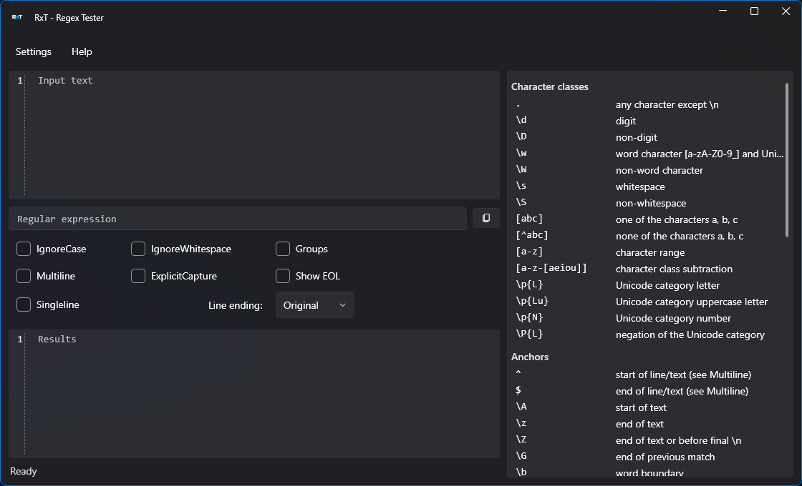
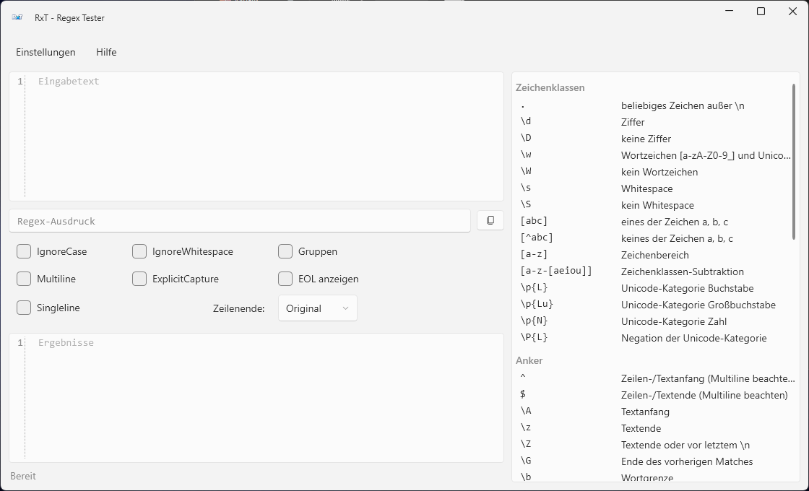

# RxT – Regex Tester

Compact, portable Windows tool for testing regular expressions (.NET flavor) against a given text.

## Features

- Live evaluation while typing, with highlighted matches in the input text
- Output of all matches with index and length, optionally including capture groups
- Regex options as checkboxes: IgnoreCase, Multiline, Singleline, IgnoreWhitespace, ExplicitCapture
- Line ending handling: original text is preserved on paste; optional conversion to CRLF, LF or CR; optional display of line endings
- Quick Reference of regex syntax elements (grouped); double-click inserts the pattern into the regex field
- Copy button for the current regex
- Themes: System (default), Light, Dark
- Languages: English (default), German, French, Spanish, Italian
- Settings (theme, language) are stored in `RxT.settings.json` next to the executable
- Single-file executable

## Screenshots



## Requirements

- Windows, 64-bit
- [.NET 10 Desktop Runtime](https://dotnet.microsoft.com/download/dotnet/10.0) (x64)

## Usage

1. Start `RxT.exe`.
2. Enter or paste the text to test into the upper field.
3. Enter the regular expression into the middle field and select the options.
4. Matches are highlighted in the upper field and listed in the lower field.

## Build

Requires the .NET 10 SDK.

```powershell
dotnet publish src\RxT.csproj -c Release -r win-x64 --self-contained false -p:PublishSingleFile=true -p:DebugType=none -p:DebugSymbols=false -o publish
```

The output is written to `publish\RxT.exe`.

## Built with

- [WPF](https://learn.microsoft.com/dotnet/desktop/wpf/) on .NET 10
- [WPF-UI](https://github.com/lepoco/wpfui)
- [AvalonEdit](https://github.com/icsharpcode/AvalonEdit)

## Note on the use of AI (voluntary)

Parts of this project (source code, tests and documentation) were created with the assistance of the AI language model Claude by Anthropic (Claude Sonnet 5.5; only this one model version was used).

## License

[MIT](LICENSE), Copyright © 2026 Alexander Feuster
